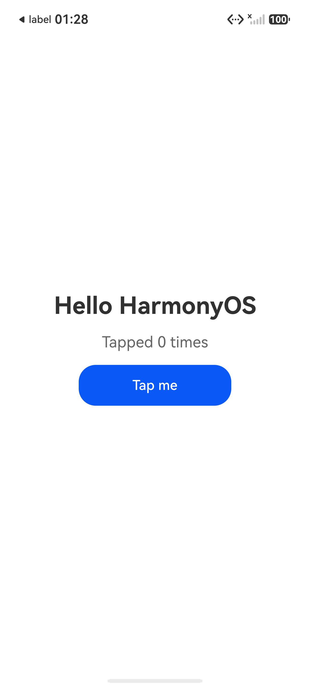

# dsh-deveco

在 DeepSeek Harness（DSH）里直接操作 **DevEco Studio** 与 HarmonyOS 工具链：发现环境、创建工程、构建 HAP、安装到真机/模拟器、启动应用、抓 hilog、截图、点按/滑动/输入，以及准备调试会话并把工程交给 DevEco Studio 做断点调试。

插件同时提供一个可拖动的 DSH 悬浮面板（构建 / 运行 / 停止 / 在 IDE 中打开），与 Agent 工具共用同一套运行时逻辑。



---

## 能力一览

| 工具 | 作用 |
|---|---|
| `deveco_status` | 发现 DevEco Studio、HarmonyOS SDK、hvigorw/ohpm/hdc/node/java、模拟器；报告当前设备、工程、应用是否在运行、上次构建结果 |
| `deveco_project_init` | 用内置 API 26 Stage 模型 ArkTS 模板创建可运行工程（AppScope / entry / EntryAbility / Index 页面 / build-profile / hvigor 配置） |
| `deveco_build` | 调用 hvigorw 构建（`assembleHap` / `assembleApp` / `clean`），自动注入 SDK 与 DevEco 自带 JBR，解析编译诊断并列出产物 |
| `deveco_device` | 列出 hdc 设备与本地模拟器实例；启动/停止模拟器；直接截取模拟器画面 |
| `deveco_install` | 安装最新 HAP（或指定 HAP）到设备，或卸载 bundle；签名失败时给出 DevEco 签名配置指引 |
| `deveco_run` | 一键构建（可选）→ 安装 → 启动，返回 PID 与可选 hilog 尾部；`debug: true` 以等待调试器模式启动 |
| `deveco_log` | hilog 实时会话（标签/级别/PID/关键字过滤）、增量读取、停止、列表，以及 faultlog 崩溃记录读取 |
| `deveco_ui` | 设备截图（作为图片返回）、布局树（含可点坐标）、tap / swipe / text / key 输入 |
| `deveco_debug` | 调试生命周期：`start` 进入等待调试器、`attach`/`detach`、`status`、`cancel`、`probe` 探测 ArkTS 调试传输、`open` 交给 IDE |
| `deveco_open` | 在 DevEco Studio 中打开工程，或定位到某个文件的某一行 |

---

## 环境要求

- Windows（插件按 Windows 路径与 `cmd` 批处理调用实现）
- DevEco Studio（含 `bin/devecostudio64.exe`、`sdk/default/openharmony`、`jbr`、`tools/emulator`）
- HarmonyOS SDK（API 12+；模板默认使用已发现 SDK 的 `platformVersion`，本机为 API 26 / 26.0.0）
- hvigor：DevEco 自带 `tools/hvigor/hvigorw.bat`，或安装 HarmonyOS command-line-tools（`bin/hvigorw.bat`，本机位于 `D:\HarmonyOS\command-line-tools`）
- 一台已经连接/启动的设备：真机（USB 调试）或 DevEco 模拟器

插件会自动发现以下位置（也可在配置里显式指定）：

| 项 | 发现顺序 |
|---|---|
| DevEco Studio | `devecoPath` → `%DEVECO_STUDIO_HOME%` → 常见安装目录（`D:\Software\DevEco Studio`、`C:\Program Files\Huawei\DevEco Studio*`） |
| SDK | `sdkPath` → `%DEVECO_SDK_HOME%` → `<DevEco>/sdk` → `<command-line-tools>/sdk` → `%LOCALAPPDATA%\Huawei\Sdk` |
| command-line-tools | `commandLineTools` → `%OHOS_CLI_TOOLS%` → `D:\HarmonyOS\command-line-tools` |
| hdc / java / node | 从 SDK toolchains、DevEco `jbr`、CLI tools 中取，最后回退到 PATH |

---

## 安装

插件已经安装进本机 `desktop` profile；**重启 DSH 后生效**（Host 插件在 profile 启动时装载，运行中的实例不会热加载新的 bundle）。

手工安装/重装：

```powershell
dsh plugin --profile desktop add "link:D:/DeepSeekHarness/dsh-deveco"
```

`dsh plugin` 会把包写进 profile 的依赖和 `dsh.profile.bundles`，bundle 自带的 `cordis.patch.yml` 负责插入插件行。

卸载：

```powershell
dsh plugin --profile desktop remove "@local/dsh-deveco"
```

---

## 快速开始

常见对话式流程（Agent 会自行选择工具）：

1. `deveco_status` — 确认 SDK、设备、工程
2. `deveco_project_init { directory: "D:/Projects/DemoApp", name: "DemoApp", bundleName: "com.example.demoapp" }`
3. `deveco_build { project: "D:/Projects/DemoApp" }`
4. `deveco_run { project: "D:/Projects/DemoApp", install: true }`
5. `deveco_ui { action: "screenshot" }` — 直接看到界面
6. `deveco_ui { action: "layout" }` — 拿到节点与坐标，再 `tap`
7. `deveco_log { action: "start", tag: "testTag" }` → `deveco_log { action: "read", sessionId: "…" }`
8. `deveco_debug { action: "start", project: … }` — 应用暂停等待调试器；随后在 DevEco Studio 里附加调试器，或 `deveco_debug { action: "open" }` 打开 IDE

只启动模拟器：

```
deveco_device { action: "list" }                        # 找实例名，例如 Mate 90 Pro
deveco_device { action: "emulator_start", name: "Mate 90 Pro" }
deveco_device { action: "emulator_screenshot", name: "Mate 90 Pro" }
```

---

## 调试说明（重要）

HarmonyOS 的**应用内断点、单步、变量查看**由 DevEco Studio 自带的调试器完成，它使用私有的 ArkTS 调试握手；`hdc` 对外暴露的是调试生命周期：

- `aa appdebug -b <bundle>` / `-p` / `-c`：设置/持久化/取消“等待调试”
- `aa start -D`：以等待调试器模式启动应用（界面停在启动页）
- `aa attach` / `aa detach`：附加/分离调试标记
- `hdc fport tcp:<port> ark:<pid>@<tid>@Debugger`：转发 ArkTS 调试传输

本插件把这一整段流程产品化：`deveco_debug start | attach | detach | status | cancel | open`，并在 `probe` 中实际建立端口转发、发起标准 CDP WebSocket 握手，报告该 ROM 是否接受通用 CDP 客户端（本机 HarmonyOS 7.0.0 / API 26 模拟器返回 400/空响应，说明只能由 DevEco Studio 的私有握手接入）。

因此推荐的调试闭环是：

1. `deveco_debug { action: "start" }` 让应用进入等待调试器状态（可复现、可脚本化）
2. `deveco_debug { action: "open", file: "entry/src/main/ets/pages/Index.ets", line: 12 }` 在 DevEco Studio 中打开工程/文件
3. 在 IDE 内打断点并启动调试；日志与界面验证继续用 `deveco_log` / `deveco_ui`
4. `deveco_debug { action: "cancel" }` 退出调试模式并结束进程

这不是“假调试”：插件负责的是设备侧真实存在的调试协议与控制面，同时明确告诉你本机 ROM 上通用 CDP 是否可用。

---

## 签名说明

- **模拟器**：本机实测可以直接安装未签名 HAP（`hvigor` 会提示 `Will skip sign 'hos_hap'`），适合开发验证。
- **真机**：必须签名。在 DevEco Studio 中打开工程 → `File > Project Structure > Signing Configs` → 勾选自动签名（需登录华为开发者账号），重新构建后 `deveco_build` / `deveco_install` 会使用工程里的 `signingConfigs`。插件检测到签名相关失败时会返回对应指引。
- 插件不会替你生成或上传证书。

---

## 配置

在 profile 的 `cordis.patch.yml` 中覆盖（所有键可选）：

```yaml
- id: dsh-deveco
  name: '@local/dsh-deveco'
  config:
    devecoPath: 'D:\Software\DevEco Studio'
    sdkPath: 'D:\Software\DevEco Studio\sdk'
    commandLineTools: 'D:\HarmonyOS\command-line-tools'
    projectRoot: 'D:\Projects\MyHarmonyApp'
    device: '127.0.0.1:5555'
    buildTimeoutMs: 900000
    defaultTimeoutMs: 60000
    logBufferLines: 5000
```

完整键说明见 [`cordis.patch.yml`](cordis.patch.yml) 顶部注释。

---

## 悬浮面板

`client.js` 在 DSH 页面注册两个槽位：

- `conversation.session.header.utilities`：记录当前会话 id（隐藏）
- `shell.overlay`：右下角可拖动卡片，显示设备/工程/运行状态，提供构建、运行、停止、打开 IDE 四个按钮

面板每 3 秒轮询状态，按钮通过 `POST /control` 触发与 Agent 工具相同的 runtime 方法；位置保存在 `localStorage`，双击复位。样式只使用 `--dsw-alias-*` 主题变量，中英文文案走 Client locale 服务。

**面板的传输方式**：桌面版 DSH 的页面以 `file://` 加载，页面里的相对 `fetch('/dsh-deveco/state')` 走 Electron IPC 桥，到达不了插件的 Host 路由（只会得到 404）。因此插件在 Host 内自己起了一个只监听 `127.0.0.1` 的小 HTTP 服务（默认端口 5731，被占用时顺延到 5740），面板先探测 `/ping` 再调用 `/state` 与 `/control`；浏览器部署下仍保留 DSH Web 服务器上的 `/dsh-deveco/*` 路由作为回退。

**面板作用于哪个工程**：按顺序解析 — 本次调用的 `project` → 会话工作目录（或其最近的工程祖先）→ 配置里的 `projectRoot` → 本进程上一次成功使用的工程 → DevEco 常用工程目录下最近修改的工程（`%USERPROFILE%\DevEcoStudioProjects`、`D:\DeepSeekHarness\projects`、`D:\Project`、`D:\Projects`）。因此当前会话不在鸿蒙工程目录里时，面板仍会落到最近工程并显示其名称，而不是把按钮全部禁用；工程路径在按钮提示（tooltip）里。运行/停止/构建/打开 IDE 四个按钮都走同一套解析逻辑。

---

## 代码结构

```
index.js            Host 入口：注册 10 个工具 + 2 条面板路由 + 卸载清理
client.js           浏览器端悬浮面板（React，无构建步骤）
src/runtime.js      共享运行时：发现、工程解析、构建→安装→启动、面板状态
src/paths.js        DevEco / SDK / CLI tools / hdc / java / node 发现与工程解析
src/project.js      JSON5 解析、工程元数据、HAP 发现、模板脚手架
src/build.js        hvigor 调用、环境注入、诊断解析、产物收集
src/device.js       hdc 封装：目标列表、安装、启动、pid、fport、文件传输
src/emulator.js     Emulator.exe：实例列表、启动/停止、截图
src/log.js          hilog 流式会话（环形缓冲、增量读取）与 faultlog
src/ui.js           截图、布局树解析、uitest 输入注入
src/debug.js        调试生命周期 + ArkTS 传输探测
src/ide.js          DevEco Studio 进程启动与文件定位
src/tools.js        10 个模型工具的 schema、参数校验、文本/图片渲染
src/control.js      面板 HTTP 路由（同源校验、JSON 边界）
templates/app/      API 26 Stage 模型 ArkTS 工程模板（含占位符）
test/               smoke / plugin / toolbar / e2e 四层测试
```

设计约束：Host 侧零依赖、不 import harness 包；所有子进程登记在 `src/exec.js`，插件卸载（HMR / profile reload）时统一 `taskkill /T` 清理，避免遗留 hvigor 守护进程或 hilog 流。

---

## 验证记录（本机实测）

环境：Windows，DevEco Studio 26.0.0.851（build 261.23567.138.36.2600851），HarmonyOS SDK 26.0.0（API 26），hvigor 6.26.8，hdc 3.2.0f，模拟器 `Mate 90 Pro`（HarmonyOS 7.0.0 / API 26）。

| 环节 | 结果 |
|---|---|
| 工具链发现 | IDE / SDK / hvigorw / hdc / jbr / Emulator 全部自动发现 |
| 模板脚手架 | 30 个文件生成，`AppScope/app.json5`、`entry/src/main/module.json5` 正常 |
| 构建 | `assembleHap` 成功，产出 `entry-default-unsigned.hap`；签名缺失作为 warning 返回 |
| 安装 | 模拟器接受未签名 HAP |
| 启动 | `aa start` 成功，PID 获取成功 |
| 截图 | 1280×2832 JPEG，应用界面正确渲染 |
| 布局/点击 | 解析到 33 个节点，定位 `Tap me` 按钮并点击，计数器从 `Tapped 0 times` 变为 `Tapped 1 times` |
| 调试 | `debug start` 成功（PID、`inDebugTransport: true`），`cancel` 成功停止 |
| 崩溃日志 | 模拟器 faultlogger 不可读时返回明确说明而不是报错 |
| 悬浮面板链路 | `test/toolbar.test.mjs`：非工程会话下 state 正确回落到 `HelloWorld`，按钮触发的 build（成功）与 run（PID 返回）均通过 HTTP 路由完成 |
| 单元测试 | `node test/smoke.mjs`、`node test/plugin.test.mjs` 通过 |

复跑测试：

```powershell
node test/smoke.mjs
node test/plugin.test.mjs
node test/toolbar.test.mjs   # 需要设备/模拟器 + 可创建软链接的权限，会构建并启动 HelloWorld
node test/e2e.mjs            # 从零脚手架到调试生命周期的完整回归
```

---

## 排错

| 现象 | 处理 |
|---|---|
| 提示找不到 SDK / hvigorw | 在 profile 配置里设置 `sdkPath`、`commandLineTools` |
| `spawn java ENOENT` | 插件通常自动使用 `<DevEco>/jbr`；若 DevEco 不在默认位置，设置 `devecoPath` 或 `javaPath` |
| `EPERM ... \.hvigor` 或软链接失败 | hvigor 需要写用户缓存并创建依赖软链接；确保 DSH 以普通桌面权限运行，且不受只读沙箱限制 |
| `no HarmonyOS device is connected` | 启动模拟器（`deveco_device emulator_start`）或连接真机并开启 USB 调试 |
| 安装报签名错误 | 在 DevEco Studio 里启用自动签名后重新构建（见“签名说明”） |
| `debug start` 后界面停在启动页 | 这是等待调试器的预期状态；用 `cancel` 退出，或在 IDE 中附加调试器 |
| 面板不出现 | 确认已重启 DSH；客户端模块只在页面加载时注册一次 |
| 面板按钮灰掉、或点了报 `The "path" argument must be of type string` | 旧版 Host 在会话不属于任何鸿蒙工程时解析不到工程；1.0.1 起会回落到最近工程。升级后需重启 DSH 让 Host 重新加载 |
| 面板提示 “restart DSH to activate it” | Host 侧代码尚未随本次启动装载，重启 DSH 即可 |
| 面板显示「应用未运行」但你已打开 DevEco Studio | 面板状态指的是**被调试的鸿蒙应用进程**，不是 IDE；同一行右侧的「IDE 已打开/未打开」才是 DevEco Studio。应用要 `deveco_run` 启动后才会显示运行中 |
| 面板显示连接不上 5731-5740 | 确认插件 Host 已随本次启动装载（`deveco_status` 的 toolbar 行会给出实际端口）；端口被其他程序占用时会自动顺延，被全部占用时会报告在 toolbar 行 |
| 插件行显示「异常 / 包不可用」 | DSH 用严格 JSON 读取插件 `package.json`：文件不能带 UTF-8 BOM，`exports` 的 `./client`、`./icon`、`./locale/*.json`、`./package.json` 必须能解析。`test/smoke.mjs` 会检查 BOM 与这些导出 |

---

## 已知限制

- 仅 Windows 路径与进程模型。
- 未实现应用内断点/单步（原因与替代方案见“调试说明”）。
- 模板固定 Stage 模型 + ArkTS；不支持 FA 模型、C++ 模块、服务卡片等模板。
- 真机签名沿用工程的 `signingConfigs`，插件不生成证书。
- 悬浮面板的视觉验证需要在重启后的 DSH 页面中人工确认（当前会话的页面无法热加载新的 Host bundle）。
